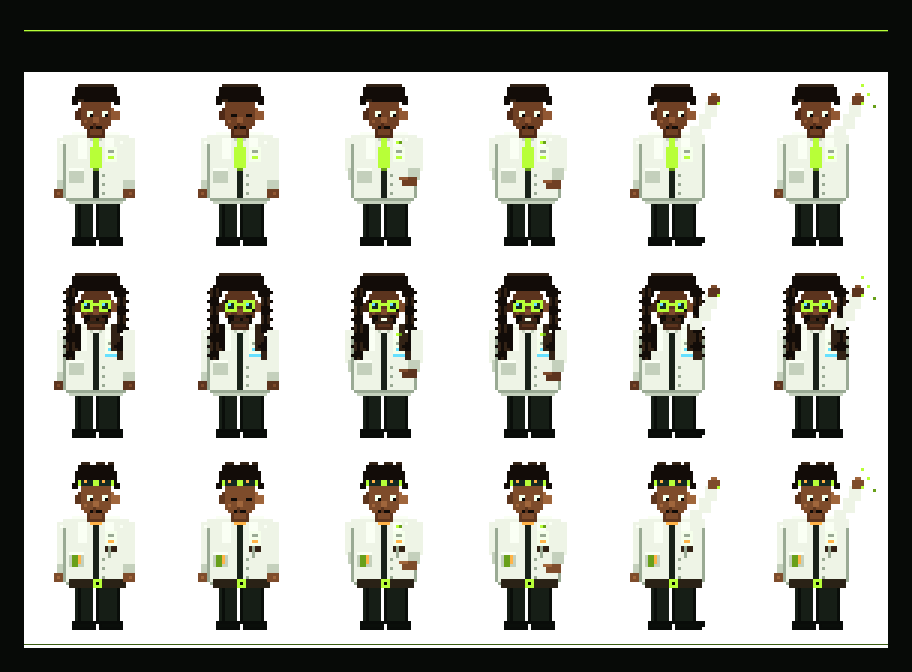

# Feather AI 2.0

**Offline, USB-first Windows diagnostics with a three-agent repair handoff.**

Feather AI 2.0 is a portable desktop app for a Windows computer that needs a
read-only checkup. Copy the folder to a USB drive, double-click `FeatherAI.exe`,
and click **Start Process**. No installer, account, API key, local model, or
internet connection is required.

The dashboard is a black-and-lime pixel-art lab. Three Black scientists in white
lab coats work at separate stations:

- **Lead** opens the job, sequences the handoffs, and writes the report.
- **Scanner** (middle station, shoulder-length dreadlocks, square glasses, short
  beard) runs the real Windows read-only checks.
- **Repair** turns the measured findings into **one** predefined proposal, then
  waits behind **Review fix** for an explicit approve or decline.



## The workflow

1. **Lead** creates a job and hands a checklist to Scanner.
2. **Scanner** runs 11 read-only Windows checks. Every result is shown as
   measured: pass, info, warning, fail, error, or **unavailable**. Unavailable is
   never counted as a pass.
3. **Repair** maps the findings to a single predefined action from a small
   catalog. Nothing runs at this point.
4. You click **Review fix**, read the action, impact, risk, and evidence, then
   **Approve fix** or **Decline**.
5. An approval is single-use. The action runs once. Declining runs nothing.
6. **Lead** writes `HTML`, `TXT`, and `JSON` reports to `reports/` beside
   `FeatherAI.exe` on the USB drive, with an audit trail and event timeline.

If the USB folder becomes read-only, the report falls back to
`Documents\Feather AI 2 Reports` and the UI says so.

## Read-only checks

| Check | What it reads |
| --- | --- |
| Operating system | Edition, build, architecture, computer name, model |
| Processor and memory | CPU, cores, installed RAM, memory pressure |
| System drive space | Free space on the Windows drive |
| Clock synchronization | Windows Time service and time source |
| Pending restart | Update/installer reboot flags |
| Automatic services | Automatic services that are stopped |
| Malware protection | Defender state, registered antivirus, recent detections |
| Host firewall | Enabled state of each firewall profile |
| Secure Boot | UEFI Secure Boot state, when supported |
| Network adapters | Local IPv4 interfaces, gateways, DNS |
| Battery health | Presence, charge, and health on laptops |

Scanner only reads. It has no repair capability in the capability gate.

## Predefined repairs

Repair chooses at most one action from this list, by deterministic ranking:

- Re-enable Windows Firewall
- Restart Print Spooler
- Restart Windows Audio
- Clear temporary files older than two days
- Flush the DNS cache
- Rebuild the icon cache (low-risk fallback)

No arbitrary shell command, downloaded script, or model-generated command can be
run. The repair id, approval token, and single-use consumption are enforced in
the main process, not just in the UI.

## Build and run

Requirements: Node.js 20 or newer.

```bash
npm install
npm test
npm run art
npm start
```

The development host is not Windows, so `npm start` loads the simulated platform
and displays a **SIMULATED PLATFORM** badge. The simulated adapter exercises the
same event contract, UI, approval gate, and report writer, but it does not touch
real Windows settings.

Build the Windows x64 zip:

```bash
npm run dist:win
```

This creates `release/FeatherAI-2.0.0-Windows-x64.zip` and
`release/win-unpacked/FeatherAI.exe`. To assemble a USB layout with a
`reports/` folder and `START-HERE.txt`:

```bash
npm run usb:win
```

Copy `usb/FeatherAI-2.0.0-Windows-x64/` to the USB drive and double-click
`FeatherAI.exe` there.

## Tests

```bash
npm test
FEATHER_SMOKE_DECISION=approve npm run smoke
FEATHER_SMOKE_DECISION=decline npm run smoke
```

The smoke test drives a complete workflow in Electron, captures a screenshot,
and writes `smoke/<decision>/result.json` plus `usb-root/reports/*.html|txt|json`.

A genuine Windows acceptance test runs the packaged executable from a
removable-drive substitute and validates the real Windows adapter, both repair
decisions, the UI DOM, and the report bundle:

```powershell
node scripts/live-windows-test.js --app-dir release/win-unpacked --usb-dir "$env:RUNNER_TEMP\FeatherUSB"
```

The GitHub Actions `Windows acceptance` workflow runs that test on
`windows-latest` and uploads the screenshots, result JSON, and reports.

## Offline and privacy guarantees

- The renderer CSP blocks network connections (`connect-src 'none'`).
- There is no telemetry, updater, analytics SDK, or remote API call.
- The app never downloads a model, signature, script, or repair payload.
- Reports contain local system information. They stay on the USB drive (or the
  documented fallback) and are never uploaded by the app.
- `audit-log.jsonl` records actions and short summaries, not evidence dumps or
  credentials.
- All artwork is generated from code by `scripts/generate-art.js`. No
  third-party art, fonts, or stock imagery is bundled.

## Documentation

- [Quick start for a USB drive](docs/QUICKSTART.md)
- [Security and privacy model](docs/SECURITY.md)
- [Testing and release evidence](docs/TESTING.md)

## License and upstream work

Feather AI 2.0 is MIT-licensed. It adapts Feather AI 1.0 code and StarNet
patterns; see [THIRD_PARTY_NOTICES.md](THIRD_PARTY_NOTICES.md) for the exact
upstream commits, reused files, and license texts.

Upstream commits:

- Feather AI: `389bfe39458e0cb0d24b0d0c8376b129a0a88380`
- StarNet (`feat/harness-backend`): `e316231d70610aac7b181c4efd1a10b3fc833cdc`

Feather AI 2.0 does not include Feather AI's model stack, chat client, API keys,
telemetry, or settings from a previous installation.
